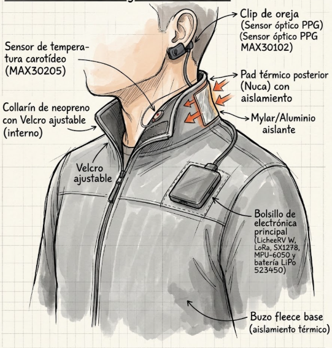

# WTS Rescue — Simulador MR de búsqueda y rescate

Juego interactivo de **realidad mixta (pantalla dividida)** basado en el
**Wearable Thermal System (WTS)** del boceto del proyecto. Un afectado atrapado
en un derrumbe lleva el WTS; un rescatista lo localiza con un rastreador LoRa
mediante una mecánica de **“calor o frío”** (la señal crece al acercarse).



## Cómo jugar

Abre `index.html` en cualquier navegador moderno (no necesita instalación ni
servidor), o sirve la carpeta:

```bash
python3 -m http.server 8000
# → http://localhost:8000
```

### Panel izquierdo — el afectado con el WTS

| Control | Sensor / subsistema WTS | Efecto en el juego |
|---|---|---|
| Deslizador de temperatura | **MAX30205** (carotídeo) + pad térmico | Fija la temperatura corporal: la FC sube con calor y baja con frío, la SpO₂ cae en extremos |
| Botón **Pad térmico** | Pad posterior de nuca con aislamiento Mylar/Al | Eleva lentamente la temperatura hacia 37 °C y gasta batería |
| Tocar el módulo WTS del cuello | **MPU-6050** (acelerómetro) | Genera el patrón de SOS |
| Botón **Forcejear** | MPU-6050 | Pico de aceleración visible en el rastreador |

**SOS por tapping (dos patrones válidos):**

1. **3 toques rápidos** sobre el módulo del collar — el patrón clásico de
   golpes de rescate de personas atrapadas.
2. **Código Morse `··· ——— ···`** — toque corto = punto, toque largo (>260 ms) = raya.

### Panel derecho — el rescatista (personaje jugable)

- Movimiento con **WASD**, **flechas** o **joystick táctil** (móvil), con
  colisiones contra los escombros.
- El **rastreador LoRa SX1278** muestra barras de señal, porcentaje, flecha de
  dirección y un radar con el blip de la víctima: cuanto más cerca, más grande
  el blip, más rápido el pitido y más altas las barras (❄ muy lejos → 🔥 muy cerca).
- Lectura en vivo de **FC (PPG)**, **SpO₂ (PPG)**, **temperatura** y **movimiento IMU**
  que transmite el WTS, con pérdida de paquetes simulada cuando la señal es débil.
- Alerta **SOS** parpadeante + alarma sonora cuando el afectado la activa.
- Llega hasta el montón de escombros con la señal de vida para completar el rescate.

## Modo difícil y fisiología letal

La víctima puede **morir** y la misión termina en derrota:

- **Barra de integridad vital (0–100 %)** y estados de conciencia: *consciente*,
  *somnoliento*, *inconsciente*, *paro cardíaco*.
- **Hipotermia:** por debajo de 34 °C empieza el daño acumulado; bajo 32 °C la
  víctima se vuelve inconsciente; cerca de 28–29 °C sobreviene el paro cardíaco.
- **Hipertermia / golpe de calor:** sobre 40 °C hay daño orgánico; sobre 41 °C
  golpe de calor; cerca de 42.5–43 °C el paro es casi inmediato.
- **Hipoxemia:** si la SpO₂ cae de 88–82 %, el daño se acelera.
- **FC crítica:** bradicardia (<30 lpm) o taquicardia (>186 lpm) también lesionan.
- La salud **se regenera** si la temperatura y la SpO₂ vuelven a rango seguro.
- El derrumbe está a **32.5 °C**: el cuerpo pierde calor de forma pasiva; el
  **pad térmico** lo contrarresta pero drena la batería LiPo, que además pierde
  rendimiento con el frío.
- Si la batería se agota, la **radio LoRa muere**: se pierde la señal y la
  telemetría; el radar conserva la **última posición conocida**. La víctima
  sigue viva y puede fallecer si no la encuentras.
- Al morir se muestra un **informe de defunción** con la causa clínica y las
  lecturas finales, junto al tono de línea plana.

Dificultad adicional del lado del rescatista: menos alcance de señal
(1150 px), 34 escombros, desplazamiento más lento y más pérdida de paquetes.

## Meta Quest / realidad virtual

Hoy el juego es una experiencia 2D que abre en el navegador del Quest como
pantalla plana. Para MR nativa (passthrough en Quest 3/3S) el camino es
**WebXR** (`immersive-ar`) con render 3D en Three.js, sirviendo la app por
HTTPS; el Quest 2 solo soporta modo VR inmersivo sin passthrough a color.

## Mapa de sensores del WTS

| Componente del boceto | Representación en la simulación |
|---|---|
| Clip de oreja **MAX30102** (PPG) | Frecuencia cardíaca y SpO₂ |
| Sensor carotídeo **MAX30205** | Temperatura corporal y estados térmicos |
| **MPU-6050** | Aceleración por tapping, SOS y forcejeo |
| **SX1278 LoRa** + LicheeRV W | Enlace telemetría/rescatista, pérdida de paquetes por distancia |
| Pad térmico nuca + Mylar/Al | Compensación de hipotermia |
| Batería LiPo 523450 | Drenaje por uso; si se agota, se pierde el enlace |

## Arquitectura

- `index.html` — aplicación completa en una sola página (HTML5 Canvas + JavaScript
  vanilla, sin dependencias ni build).
- `docs/wts-boceto.png` — boceto original de referencia del WTS.

## Notas sobre la realidad mixta

La experiencia implementa el paradigma MR de **perspectivas duales
sincronizadas** (estado fisiológico real del wearable + vista de operación en
campo). Como evolución natural puede llevarse a WebXR/Quest o añadir un
streaming de datos real desde un prototipo WTS físico mediante WebSerial/MQTT.
